<div align="center">


# BasketLens

### E-commerce customer behaviour and sales analytics, from raw transactions to decisions

[](https://github.com/Padu28/ecommerce-sales-analytics/actions/workflows/ci.yml)
[](https://padu28.github.io/ecommerce-sales-analytics/)


[](LICENSE)

**[Open the live dashboard](https://padu28.github.io/ecommerce-sales-analytics/)** &nbsp;|&nbsp; [Methodology](docs/methodology.md) &nbsp;|&nbsp; [Notebook](notebooks/ecommerce_analytics.ipynb) &nbsp;|&nbsp; [Big-data layer](bigdata/README.md) &nbsp;|&nbsp; [Power BI guide](powerbi/README.md)

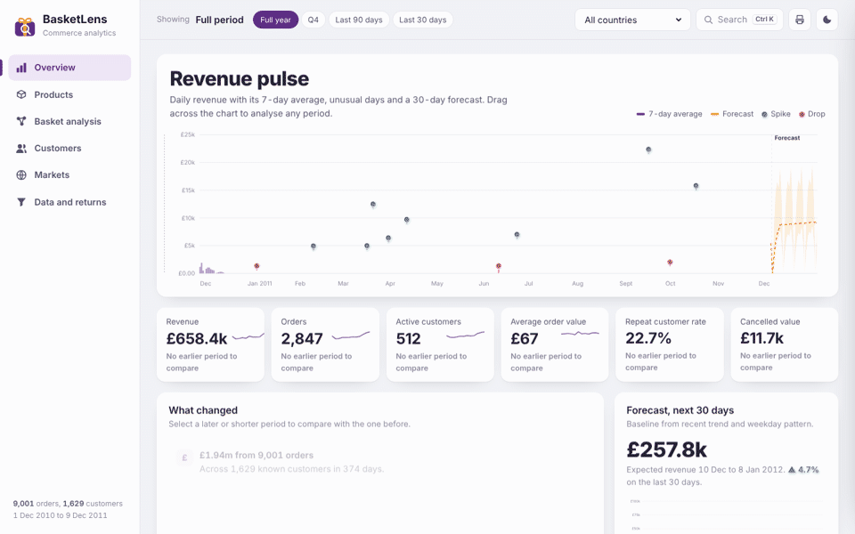

</div>

---

## Contents

- [The business problem](#the-business-problem)
- [What BasketLens delivers](#what-basketlens-delivers)
- [Architecture](#architecture)
- [Dashboard guide](#dashboard-guide)
- [Quick start](#quick-start)
- [Analytics methods](#analytics-methods)
- [Big-data layer](#big-data-layer)
- [Power BI](#power-bi)
- [Project structure](#project-structure)
- [Data](#data)
- [Testing and CI](#testing-and-ci)
- [Roadmap](#roadmap)
- [About](#about)

## The business problem

An online gift retailer in the UK sells thousands of products to retail shoppers and wholesale buyers in nearly 40 countries. Every day it records hundreds of invoice lines, including cancellations, returns, guest checkouts and the odd data-entry error. The commercial team needs straight answers to questions like these:

- **Sales:** How are we trending? Which days were unusual, and what should we expect next month?
- **Customers:** Who are our best customers, who is slipping away, and do new customers come back?
- **Products:** Which few products drive most revenue, what gets returned, and what is bought together?
- **Markets:** How much depends on the UK, and which international markets are growing?
- **Trust:** How much of the raw data is usable, and what was removed and why?

BasketLens answers them with one tested pipeline that produces the same numbers everywhere: a Python package, a big-data stack (Hadoop, Hive, Spark, MongoDB, Cassandra), Power BI tables and an interactive web dashboard that anyone can open in a browser.

## What BasketLens delivers

| Area | Capability |
| --- | --- |
| **Data engineering** | Typed cleaning with a full **data-quality audit**: every rule, rows removed and rows remaining. Cancellations kept for returns analysis; guest checkouts kept for revenue but excluded from customer analytics |
| **Sales intelligence** | KPIs with **period-over-period comparison**, daily/monthly trends, weekday × hour ordering pattern, **anomaly detection** for spikes and drops, **30-day revenue forecast** with an 80% band |
| **Customer analytics** | **Six-segment RFM** model, average order value, buying interval, probability still active, **12-month customer lifetime value**, churn flag, recommended action per customer, **monthly cohort retention** |
| **Product analytics** | **ABC (Pareto) classification**, return rates, monthly trends per product |
| **Market-basket analysis** | **Association rules** (support, confidence, lift) for cross-selling and bundles; MLlib **FP-Growth** in Spark |
| **Markets** | Country performance, growth vs previous period, home vs international mix, order value by market |
| **Big data** | Hive raw → clean → mart warehouse (partitioned Parquet), Hadoop Streaming with combiner, PySpark ETL, idempotent MongoDB documents, query-first Cassandra tables, Docker Compose |
| **Delivery** | Animated web dashboard (no install, works offline), Power BI measures and theme, CSV exports, PDF executive report, Jupyter notebook, CLI |
| **Quality** | Unit tests including cross-checking MapReduce against pandas, linting, GitHub Actions CI and automatic GitHub Pages deployment |

## Architecture

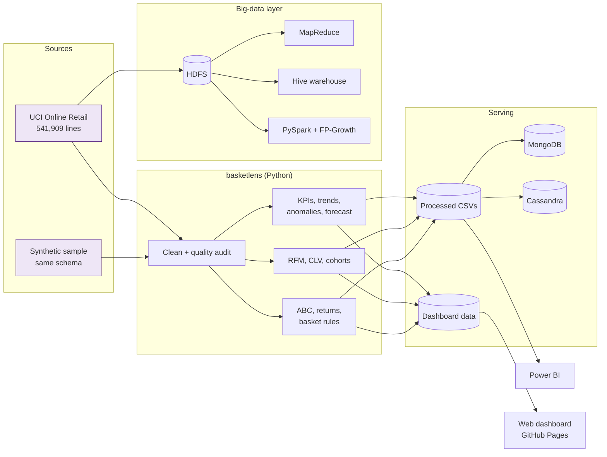

The same cleaning rules and segment definitions are implemented in pandas, Hive SQL and PySpark, so results agree whichever engine runs them.

## Dashboard guide

The dashboard has six pages in the left sidebar (keys <kbd>1</kbd>–<kbd>6</kbd>). The **date range** and **country** at the top apply to Overview and Markets; Products, Basket analysis and Customers cover the full history. Everything you choose is saved in the page address, so you can copy the URL and send a colleague exactly what you see.

### 1. Overview: the revenue pulse

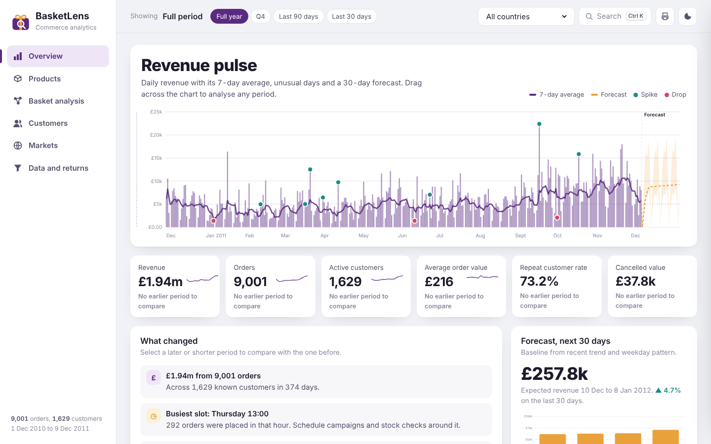

The first thing a manager sees each morning.

- **Revenue pulse (top).** Daily revenue as bars, with the 7-day average as a line. **Green pins** mark unusual spikes and **red pins** unusual drops; hover a pin for the day's revenue against what is normal for that weekday, or click it to zoom to that week. The dashed **orange line** on the right is the 30-day forecast, with its shaded 80% range.
- **KPI cards.** Revenue, orders, active customers, average order value, repeat customer rate and cancelled value, each with a small trend line for the selected period.
- **What changed.** Short, automatically written findings: the size and direction of the revenue change, which market drove it, the busiest ordering hour, how concentrated revenue is in the top 10% of customers, new customers and unusual days.
- **Forecast, next 30 days.** Expected revenue, change on the last 30 days, weekly breakdown and range.
- **When customers order.** A weekday × hour heatmap of orders. Darker cells are busier. Saturdays are empty because the business doesn't trade then.
- **Top markets.** Revenue by country for the period; click a country to filter the whole page.

### 2. Analyse any period by dragging

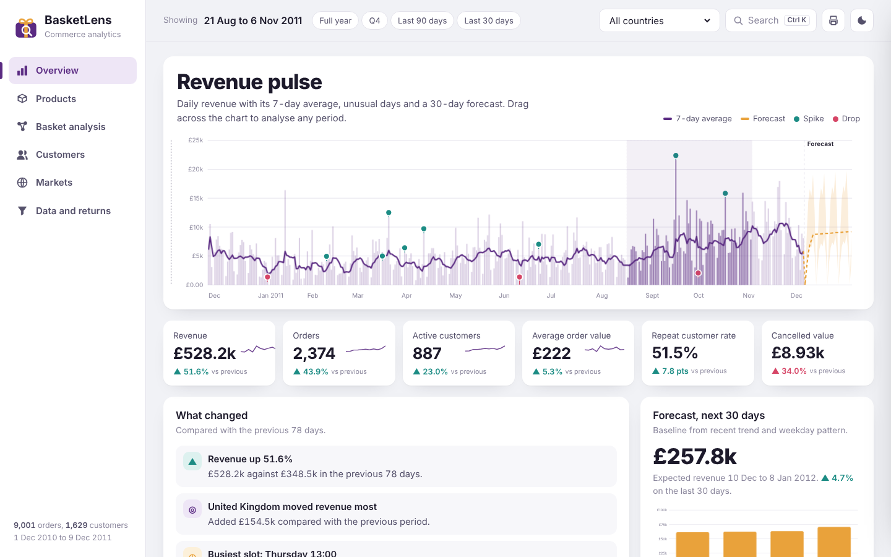

Click and drag across the revenue pulse to select any period, or use the **Q4**, **Last 90 days** and **Last 30 days** buttons. Every KPI is then **compared with the previous period of the same length**: green arrows for improvements, red for declines (for cancelled value, lower is better, so a fall is green). The insights rewrite themselves for the new period. Double-click the chart or press **Full year** to reset.

### 3. Products: what drives revenue

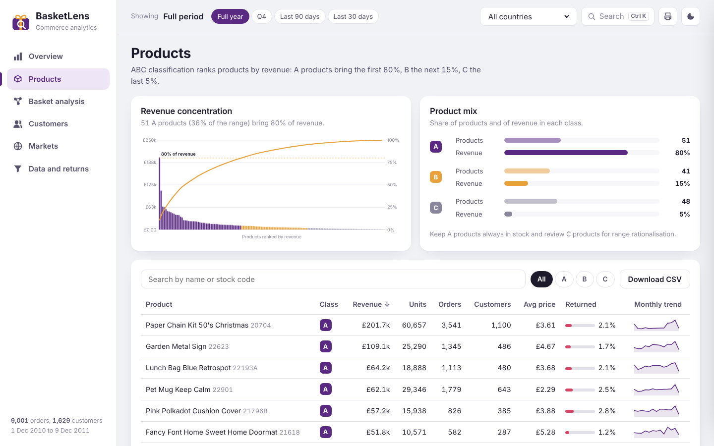

- **Revenue concentration.** Products ranked by revenue (bars, coloured by class) with the cumulative share (orange line). Where the line crosses the dashed 80% mark shows how few products bring most of the money.
- **Product mix.** For each ABC class, the share of products against the share of revenue. A products should never run out of stock; C products are candidates for range review.
- **Product table.** Search by name or stock code, filter by class, sort any column. Each row shows revenue, units, orders, customers, average price, **return rate** and a 12-month trend line. **Download CSV** exports what you see.

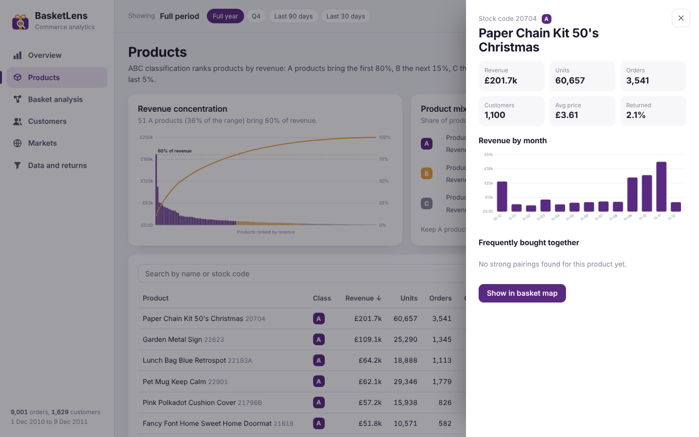

Click a product to open its **profile**: key figures, revenue by month and **frequently bought together** items with their lift.

### 4. Basket analysis: what customers buy together

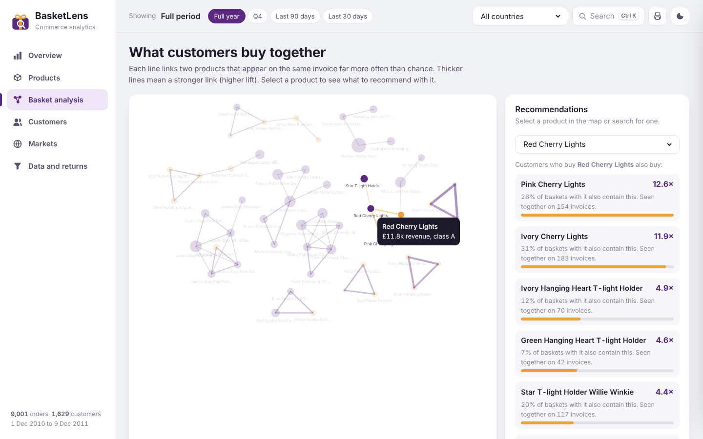

- **Basket map.** Each circle is a product (size = revenue, colour = ABC class). A line joins two products that appear on the same invoice far more often than chance; thicker lines mean a stronger link. Groups of linked products are natural **bundles** and **cross-sell** opportunities.
- **Recommendations.** Click a product, or choose one from the list, to highlight its links and see what to recommend with it: the **lift** (how many times more likely than chance), the confidence and how many invoices had both.
- **Association rules.** The full rule table, filtered by a minimum-lift slider and exportable for merchandising or a recommendation engine.

### 5. Customers: who to look after

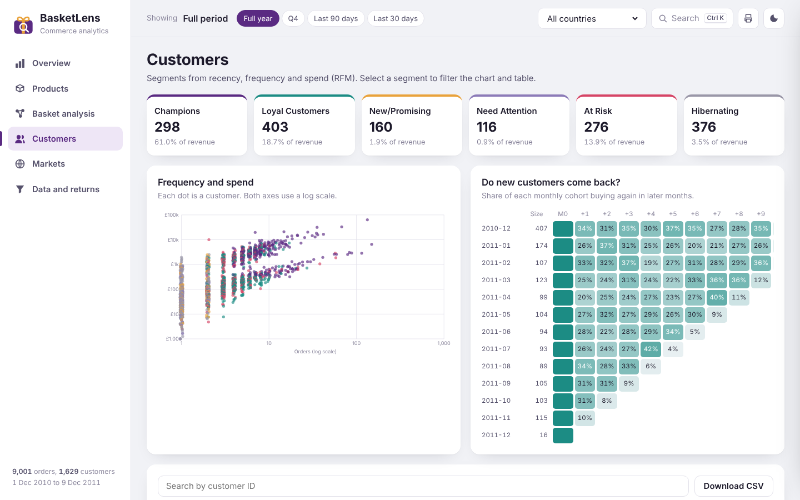

- **Segment tiles.** Customers in each of the six RFM segments and their share of revenue. Click a tile to filter the chart and table.
- **Frequency and spend.** Each dot is a customer, coloured by segment, on log scales. Champions sit top right; the selected segment stays bright while the rest fade.
- **Do new customers come back?** Monthly acquisition cohorts. Each row is the month customers first bought; each cell is the share who bought again that many months later.
- **Customer table.** Orders, revenue, average order, days since last order, **expected revenue in the next 12 months** and **chance still active**, with a monthly spend trend.

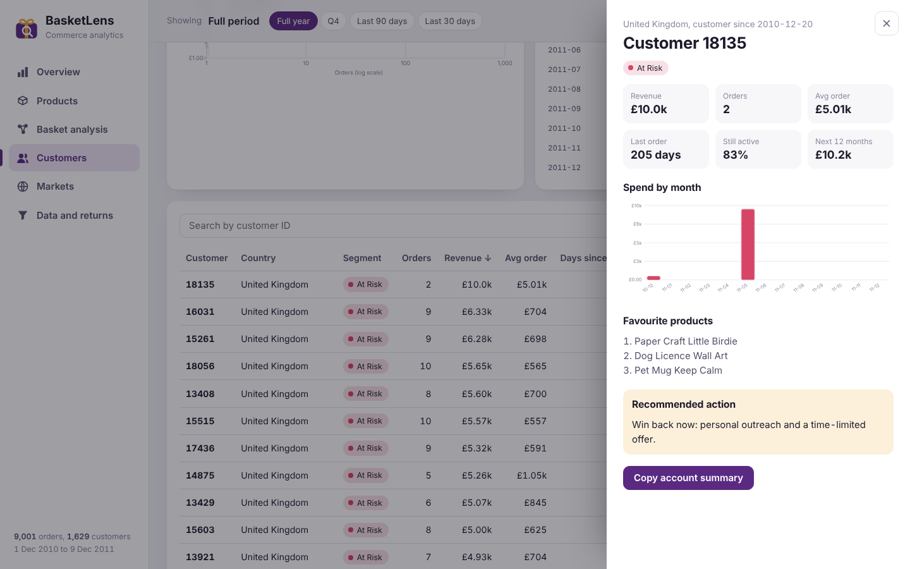

Click a customer for their **profile**: spend by month, favourite products, the recommended action for their segment and **Copy account summary**, which puts a ready-to-read briefing on the clipboard for a call or CRM note.

### 6. Markets

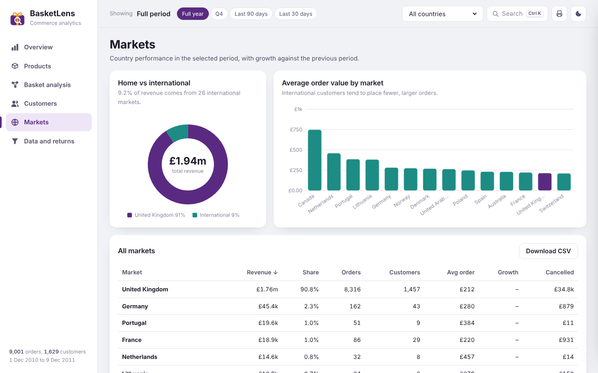

Home vs international revenue split, average order value by market (international buyers tend to place fewer, larger orders), and a table of every market with share, orders, customers, order value, **growth against the previous period** and cancelled value. Click a market to filter the Overview.

### 7. Data and returns

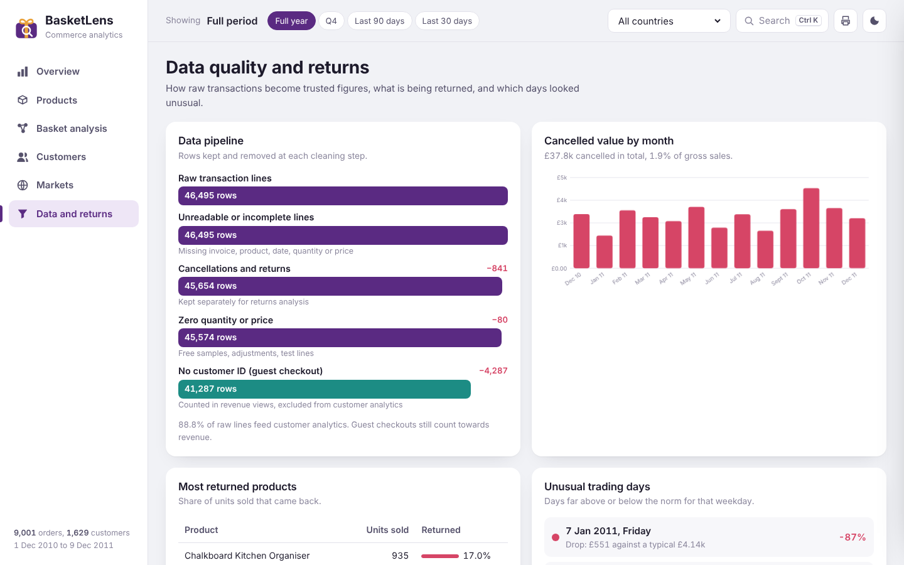

- **Data pipeline.** Rows kept and removed at each cleaning step, so anyone can see how raw lines become trusted figures.
- **Cancelled value by month** and **most returned products** (share of units sold that came back).
- **Unusual trading days.** Every detected spike and drop, with revenue against the norm. Click one to jump to that week on the Overview.

### Search, export, themes and mobile

<table>
<tr>
<td width="62%">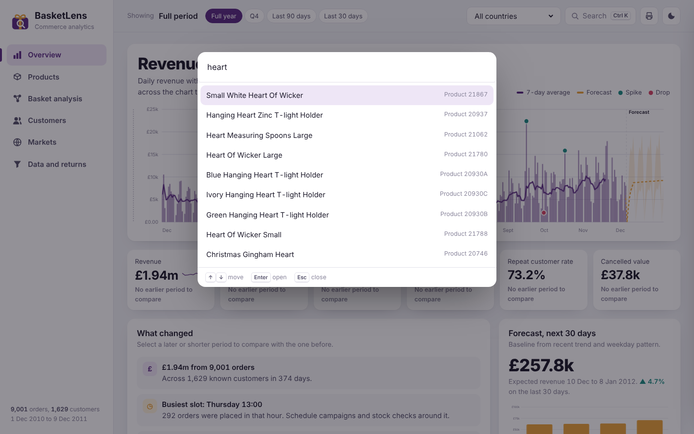</td>
<td width="38%">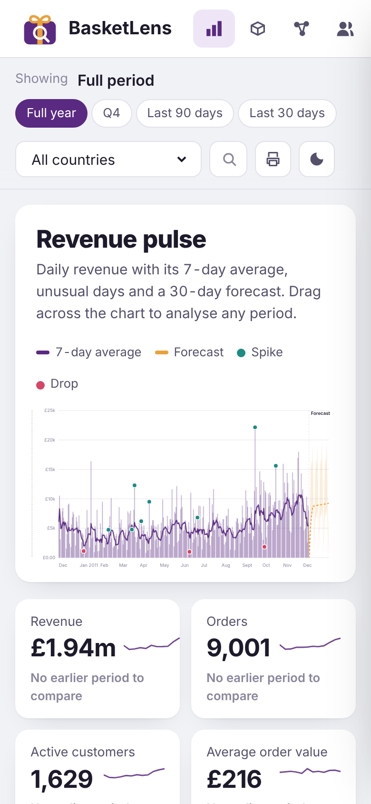</td>
</tr>
<tr>
<td><b>Command palette.</b> Press <kbd>Ctrl</kbd>+<kbd>K</kbd> (or <kbd>/</kbd>) to jump to any product, customer, market or page.</td>
<td><b>Mobile.</b> The layout adapts to phones and tablets.</td>
</tr>
</table>

<p align="center">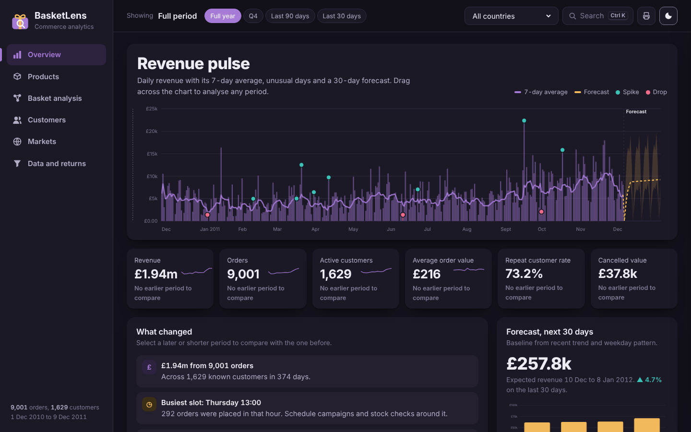<br><em>Dark theme: press <kbd>D</kbd> or the moon button.</em></p>

| Feature | How |
| --- | --- |
| Executive PDF report | Printer button in the top bar: every page, laid out for A4 landscape |
| CSV export | *Download CSV* on products, rules, customers and markets |
| Share a view | Copy the URL: range, country, page and segment are kept |
| Keyboard | <kbd>Ctrl K</kbd> search, <kbd>1</kbd>–<kbd>6</kbd> pages, <kbd>D</kbd> theme, <kbd>Esc</kbd> close |

## Quick start

Requires Python 3.10 or newer. The core pipeline needs only pandas and numpy.

### Windows with VS Code

1. Download the code: `git clone https://github.com/Padu28/ecommerce-sales-analytics.git`, or *Code > Download ZIP* and unzip.
2. In VS Code: *File > Open Folder*, then *Terminal > New Terminal*.
3. Create an environment and install:
   ```powershell
   python -m venv .venv
   Set-ExecutionPolicy -Scope Process -ExecutionPolicy Bypass   # only if PowerShell blocks the next line
   .venv\Scripts\activate
   pip install -e ".[dev,notebook]"
   ```
4. Run the analytics. A data-quality report, KPIs and segments print in the terminal:
   ```powershell
   basketlens run
   ```
5. Open the dashboard at **http://localhost:8000** in Chrome or Edge, or simply double-click `dashboard/index.html`:
   ```powershell
   python -m http.server 8000 --bind 127.0.0.1 --directory dashboard
   ```

### macOS / Linux

```bash
git clone https://github.com/Padu28/ecommerce-sales-analytics.git
cd ecommerce-sales-analytics
python3 -m venv .venv && source .venv/bin/activate
pip install -e ".[dev,notebook]"
basketlens run
python3 -m http.server 8000 --directory dashboard     # http://localhost:8000
```

### With the real UCI dataset

```bash
pip install ucimlrepo
basketlens download                                    # 541,909 lines -> data/raw/online_retail_full.csv
basketlens run --input data/raw/online_retail_full.csv
```

<details>
<summary>Example output</summary>

```
BasketLens  |  2010-12-01 to 2011-12-09  |  1.0s

  Data quality
    Raw transaction lines                      0 removed      46,495 remaining
    Unreadable or incomplete lines             0 removed      46,495 remaining
    Cancellations and returns                841 removed      45,654 remaining
    Zero quantity or price                    80 removed      45,574 remaining
    No customer ID (guest checkout)        4,287 removed      41,287 remaining

  Headline KPIs
    Revenue                          £1.94m
    Orders                            9,001
    Customers                         1,629
    Average order value             £215.73
    Repeat customer rate              73.2%
    Cancellation rate                  1.9%

  Customer segments
    Champions             298 customers    61.0% of revenue
    Loyal Customers       403 customers    18.7% of revenue
    ...
  Strongest basket rule: ALARM CLOCK BAKELIKE GREEN -> ALARM CLOCK BAKELIKE WHITE (lift 30.7, confidence 46%)
  Anomalous trading days: 11
```
</details>

**From Python:**

```python
import basketlens as bl

result = bl.run(bl.load("data/raw/online_retail_sample.csv"))
result.kpis                 # headline KPIs
result.customers.head()     # RFM, segment, CLV, action per customer
result.rules.head()         # market-basket rules
result.anomalies            # unusual trading days
bl.export(result, "data/processed", "dashboard/data/basketlens_data.js")
```

**Notebook:** [`notebooks/ecommerce_analytics.ipynb`](notebooks/ecommerce_analytics.ipynb) walks through every step with charts.

## Analytics methods

| Method | Summary |
| --- | --- |
| Cleaning | Cancellations (`C` invoices, negative quantities), zero prices, incomplete lines and guest checkouts handled by explicit, audited rules |
| RFM | Quintile scores; six segments: Champions, Loyal Customers, New/Promising, Need Attention, At Risk, Hibernating |
| Customer value | AOV × expected orders in 12 months × probability still active, based on each customer's own buying interval |
| Cohorts | Monthly acquisition cohorts, retention and revenue |
| ABC | Cumulative revenue share: A ≤ 80%, B ≤ 95%, C the rest |
| Basket rules | Pairwise support, confidence and lift over invoices; FP-Growth in Spark |
| Anomalies | Robust z-score against the same weekday over 8 weeks, plus a collapse rule for drops |
| Forecast | Recent linear trend × weekday profile, 80% band from residuals |

Formulas, thresholds and limitations: [docs/methodology.md](docs/methodology.md).

## Big-data layer

| Tool | What it adds |
| --- | --- |
| **Hadoop MapReduce** | Revenue by country, month, product or hour with a combiner; runs locally without Hadoop for testing |
| **Hive** | Raw → clean → mart warehouse, Parquet partitioned by month, views for KPIs, RFM (`NTILE`) and basket pairs with lift |
| **PySpark** | Distributed cleaning, partitioned Parquet, RFM with window functions, MLlib FP-Growth basket rules |
| **MongoDB** | Invoice documents with embedded line items and customer profiles; idempotent bulk upserts, indexes, example aggregations |
| **Cassandra** | Tables modelled per query: orders by customer, sales by day and country, product daily demand, CRM profile |
| **Docker Compose** | Local MongoDB and Cassandra in one command |

```bash
bash bigdata/mapreduce/run_streaming.sh --local country      # try MapReduce without Hadoop
docker compose -f bigdata/docker-compose.yml up -d            # MongoDB + Cassandra
```

Details: [bigdata/README.md](bigdata/README.md).

## Power BI

[`powerbi/`](powerbi/README.md) contains DAX measures (the original KPIs plus cancellation rate, guest share, month-on-month growth, 7-day average, top-10% share, at-risk revenue, CLV and forecast), a matching colour theme and a page-by-page build guide for an executive overview, products, basket analysis, customers, markets and data-quality page.

## Project structure

```
ecommerce-sales-analytics/
├── src/basketlens/          Python package
│   ├── data.py              loading, cleaning, data-quality report
│   ├── trends.py            KPIs, trends, weekday x hour, anomalies, forecast, markets
│   ├── customers.py         RFM, CLV, churn, cohorts
│   ├── products.py          product performance, ABC, returns, basket rules
│   ├── pipeline.py          end-to-end run, Power BI CSVs, dashboard data
│   └── cli.py               `basketlens` command
├── dashboard/               web dashboard (HTML, CSS, JS; deployed to GitHub Pages)
├── bigdata/                 hive/, mapreduce/, spark/, mongodb/, cassandra/, docker-compose.yml
├── powerbi/                 DAX measures, theme, build guide
├── notebooks/               ecommerce_analytics.ipynb
├── data/                    raw/ (sample), sample/ (authentic UCI lines), processed/ (outputs)
├── scripts/                 generate_sample_data.py
├── tests/                   pytest suite
├── docs/                    methodology, publishing guide, screenshots
└── .github/workflows/       CI and Pages deployment
```

## Data

The analysis is built for the **UCI Online Retail** dataset: Chen, D. (2015), *Online Retail*, UCI Machine Learning Repository, [doi:10.24432/C5BW33](https://doi.org/10.24432/C5BW33), CC BY 4.0. It covers a UK-based online gift retailer between December 2010 and December 2011.

The repository ships a **synthetic sample** with the same schema and characteristics (UK-heavy, Christmas peak, no Saturday trading, wholesale quantities, cancellations, guest checkouts) so the project runs anywhere without a download. **All figures in the screenshots come from that synthetic sample**; run the pipeline on the real dataset for real figures. See [data/README.md](data/README.md).

## Testing and CI

```bash
pip install -e ".[dev]"
ruff check src tests scripts bigdata
pytest
```

Tests cover the cleaning rules against authentic UCI lines, RFM scoring and segment coverage, the maths of association rules on a hand-checked example, anomaly detection on planted spikes and drops, forecast bounds, the full pipeline and exports, and a cross-check that the MapReduce job gives the same totals as pandas.

GitHub Actions runs linting, tests on Python 3.10, 3.12 and 3.13, a pipeline smoke test and a MapReduce smoke test on every push. A second workflow rebuilds the dashboard data and deploys it to GitHub Pages.

## Roadmap

- [ ] Product recommendations served from an API (FastAPI) using the basket rules
- [ ] Fitted CLV (BG/NBD + Gamma-Gamma) as an optional model
- [ ] Scheduled pipeline with Airflow or Prefect and incremental loads
- [ ] Forecasting with Prophet or LightGBM and backtesting
- [ ] Product category taxonomy for category-level analysis

## About

Built by **Padmashree Shah** ([GitHub @Padu28](https://github.com/Padu28) · [Padmashreeshah@gmail.com](mailto:Padmashreeshah@gmail.com)). Code released under the [MIT License](LICENSE); the UCI dataset is CC BY 4.0.
